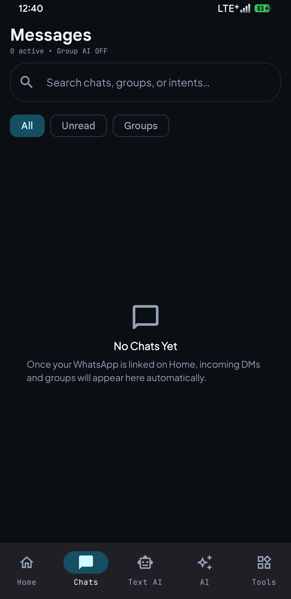
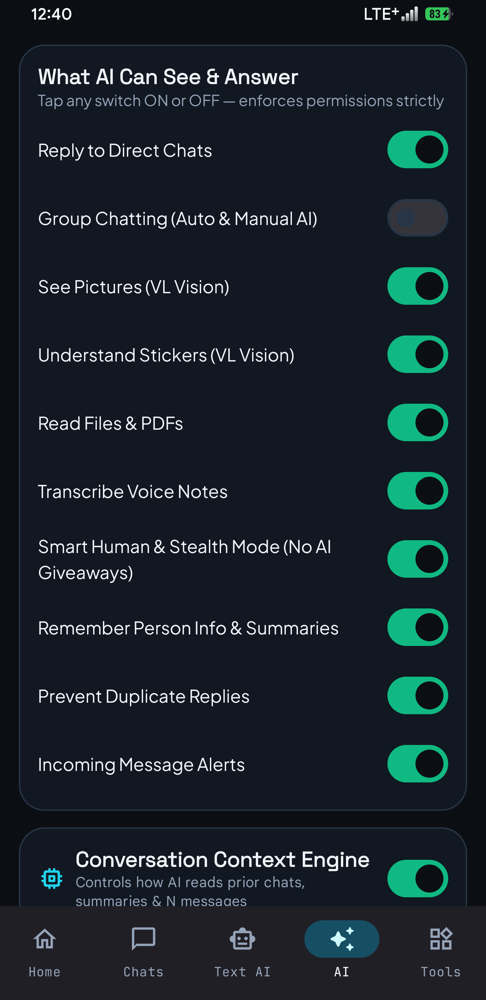

# 🚀 ClawLink WA — AI WhatsApp Auto-Reply on Android

<p align="center">
<b>Install → Scan QR → Your AI answers your WhatsApp chats automatically.</b>
</p>

<p align="center">
<a href="https://github.com/franklinatongo-code/clawlink-wa/releases/latest"></a>
<a href="#"></a>
<a href="#"></a>
<a href="#"></a>
<a href="#"></a>
<a href="#"></a>
<a href="https://github.com/franklinatongo-code/clawlink-wa/releases/latest/download/ClawLink-WA-1.0.apk"></a>
</p>

---

### What it does

**ClawLink WA turns your Android phone into an AI WhatsApp agent.** It loads the real WhatsApp Web client inside your phone's own browser (WebView), pairs just like WhatsApp Desktop, and lets an AI answer chats, understand photos/voice/PDFs, run on a schedule, and act as your chat assistant — **24/7, hands-free.**

No computer. No Node.js. No self-hosted server. No re-inventing the WhatsApp protocol. Just install the APK on your phone, link your number once, and let the AI do the talking.

## 📸 See what you get

Screenshots from the current build. Every screen is a tool you can use on day one.

| Screenshot | What you can do with it |
|:---:|---|
|  | **Link once, then forget it.**<br>Scan a QR — or use an 8-digit code if your camera is busy — and ClawLink becomes a linked device, just like WhatsApp Desktop. The session stays on your phone, so you never scan again.<br><br>• QR with countdown + instant refresh<br>• "Use Phone Instead" pairing code<br>• Live WhatsApp Web view<br>• One-tap switch account |
|  | **Every chat, one clean workspace.**<br>Direct messages and groups land in a frosted-glass inbox with live AI status, so you always know what the agent is doing.<br><br>• Search contacts, groups and previews<br>• Filter All / Unread / Groups / Direct / Leads<br>• Unread badges + animated AI rings<br>• Tap a chat to reply, summarize, translate or export |
|  | **An assistant that can actually use WhatsApp.**<br>Ask in plain English and watch it work — replies stream in while it shows each tool it runs.<br><br>• "Summarize my chat with John"<br>• "Text Mary I'll be 10 minutes late"<br>• Attach a photo or PDF for instant answers<br>• Save facts, set reminders, schedule messages |
|  | **You decide what the AI can see and do.**<br>Fine-grained switches and permission tiers mean it never touches more than you allow.<br><br>• Direct chats and groups on separate switches<br>• Pictures, stickers, files/PDFs, voice notes<br>• Stealth mode — no AI giveaways<br>• Duplicate-reply protection + context engine |
|  | **100+ tools in the same app.**<br>Stop installing ten utilities — the whole toolbox ships inside ClawLink.<br><br>• Vision + file tester<br>• Scheduled messages that send while the app is closed<br>• Quiet hours, away mode, keyword rules, broadcast<br>• QR maker, text/crypto/dev/math/finance calculators |
|  | **Talk to it. Make it sound like you.**<br>Choose how voice notes are transcribed and exactly how replies read.<br><br>• Voice: Off / Cloud / Offline (Vosk)<br>• NVIDIA NIM audio models (Parakeet, Canary, Whisper, Phi‑4)<br>• Reply styles: Natural Human, Short & Crisp, Formal<br>• Business Mode with live CRM |

<p align="center">
<b>One APK. No PC. No server. No Node. No extra apps.</b><br><br>
<a href="https://github.com/franklinatongo-code/clawlink-wa/releases/latest/download/ClawLink-WA-1.0.apk"></a><br>
<sub>Android 7.0+ · ~66 MB · link with a QR and you're live in under a minute</sub>
</p>

---

## 🔥 Caught in the wild

Not a mockup. These are real WhatsApp conversations answered by the agent — no scripts, no canned lines, just the model doing its thing.

| | |
|:---:|:---:|
|  |  |
| **It gets the joke.**<br>DLSS on an M5 MacBook? It fires back on the spot — then rolls with the dog pic like nothing happened. | **It reads the room — and the screenshot.**<br>Sent a snapshot of an iMessage thread, it caught the "Ryan energy", kept the banter going and asked if you're down for the game. |

<p align="center">
<sub>Names and chats shown with the owner's permission · want the same on your number?</sub><br>
<a href="https://github.com/franklinatongo-code/clawlink-wa/releases/latest/download/ClawLink-WA-1.0.apk"><b>⬇️ Download ClawLink WA</b></a>
</p>

---

## ✨ Features

A full AI WhatsApp agent and productivity suite in one APK — not just a reply bot.

<details open>
<summary><b>📲 Linking, persistence & background operation</b></summary>

- **Fast QR pairing** with countdown and instant refresh, **8-digit phone-number pairing code**, and an optional **Live WhatsApp Web** view to inspect or interact with the session
- **Persistent login** — cookies, localStorage and IndexedDB are kept on-device with auto-reconnect, so you scan once
- **One-tap Switch Account** — cleanly signs out and shows a fresh QR
- **24/7 background operation** — foreground service, WakeLock, keepalive alarms, and boot/update auto-restart receivers
- **Readiness checks** (unrestricted battery, notifications, microphone) and a **Quick Settings tile** to toggle auto-reply from the shade
- **Home overview** — Online/Saved/Scan badge, Chats / Messages / AI Replies stats, media toggles, and a **1-tap WhatsApp Catch-Up** briefing
- **Hidden owner key vault** behind the header badge — PIN-protected reveal/copy/activate for your API key

</details>

<details>
<summary><b>🤖 AI agent & group intelligence</b></summary>

- **8-way parallel, deduplicated pipeline** — durable Room job queue plus per-chat reply locks, so duplicate events never double-reply while different chats reply concurrently
- **Group intelligence** — separates 1:1 from groups, extracts participant names/JIDs and @mentions, keeps per-group memory, and supports **Mention-Only** mode
- **Hard send-layer group protection** — when group replies are OFF, messages are blocked at the send/schedule layer, not just by prompt
- **Media understanding** — vision for photos (retries blurry/refusal results with high-res + contrast), static/animated WebP and Lottie stickers, PDFs/documents, and voice notes via Cloud AI or **offline Vosk**
- **Natural realism** — typing indicators, read receipts, delay slider, quote replies, optional AI signature
- **Prompt-injection guard** and per-chat permission tiers (Standard / Restricted / Trusted / Blocked)

</details>

<details>
<summary><b>💬 Chats workspace & manual AI backup</b></summary>

- **Frosted-glass, sci-fi UI** — single-pane phone layout and list-detail tablet/foldable layout with animated AI status rings
- **Filters & live search** — All, Unread, Groups, Direct, Leads & CRM; search contacts and previews
- **Business Command HUD** — live CRM metrics (leads, sales, support, urgent, appointments) and per-chat category badges
- **Rich bubbles** — group participant labels, quoted previews, media/voice insight chips, Inspect Media, Translate, Read Aloud, Dictation, Export to Markdown
- **Manual AI dock** — Reply with AI Now, Keep Replying catch-up mode, Smart Draft into the composer, 1-tap Summarize
- **Quick snippets & attachments** from the composer
- **Per-contact / per-group rules** — auto-reply toggle, permission tier, custom prompt, language, style, context/N-message overrides, CRM category and saved memory facts

</details>

<details>
<summary><b>🧠 Personal assistant (Text AI)</b></summary>

- **iMessage-style chat** — streamed replies, live tool status, reactions, copy, delete, TTS and dictation
- **Natural-language WhatsApp control** — list chats, read/summarize a conversation, update a contact's instructions, save a fact, send a message (respecting group permissions), or schedule one
- **Multimodal attachments** — images via Android Photo Picker, plus PDFs/audio/text for visual Q&A, OCR and transcription
- **Contact picker shortcut** and built-in math + device telemetry tools

</details>

<details>
<summary><b>⚙️ AI brain, context & multi-provider studio</b></summary>

- **Capability toggles** for direct chats, groups, pictures, stickers, files/PDFs, voice and alerts
- **Voice mode switch** — Off / Cloud / Offline (Vosk) with downloadable language packs
- **Personality presets** (Friendly Helper, Short & Crisp, Business Formal, Study Tutor, Code Helper, Translator) plus temperature, tokens, delay, streaming, name, prompt, style and language
- **Context modes** — Hybrid Recent + Summary, Recent only, Summary only — with an N-message reader (1–50) and cached media insights
- **Business Mode setup** — brand name, reply tone, and a products/services/pricing/hours catalog
- **Multi-provider routing** — NVIDIA NIM or a custom OpenAI-compatible endpoint, encrypted key, live endpoint tester, **automatic fallback provider**, and a searchable model catalog (All / Vision / Tools / Audio) assigning separate chat, vision and voice models

</details>

<details>
<summary><b>🧰 Automation, productivity & utility hub</b></summary>

- **WhatsApp automation** — scheduled message queue (sends while the app is closed), Quiet Hours/DND with VIP bypass, Away/Vacation auto-reply, keyword rules (contains / exact / prefix / regex), welcome messages, auto-react, cooldown, snippets, multi-chat broadcast, token leaderboard
- **Vision & file tester** — run any photo, WebP sticker or PDF through the media pipeline
- **Focus & notes** — Pomodoro, stopwatch, box breathing, to-do list, habit streaks, quick notes, scratchpad, TTS pad
- **QR & text** — QR maker (URL/text/wa.me/Wi-Fi), WhatsApp formatting, word/char/line/reading-time stats, case converters, slugger, sort/dedupe/number, extractors, word frequency
- **Math, finance & health** — scientific evaluator, 8-category unit converter, tip splitter, loan/EMI, BMI, event countdowns
- **Dev & crypto** — password/passphrase/UUID, JSON, Base64, URL, Hex, Binary, SHA-256/512, MD5, HMAC-SHA256, JWT, regex tester, epoch, ROT13, Morse, world clocks, WCAG contrast, dice/coin/random
- **Device & diagnostics** — Light/Dark/OLED/System themes, haptics, CPU/RAM/storage/battery/network telemetry, JSON backup & restore (API keys excluded), E2EE session stats, AI/WhatsApp diagnostics and categorized live logs

</details>

---

## 🚀 Get started in 60 seconds

**1. Download**

Pick an edition — same app, different theme (different package names, so both can be installed side by side):

| Edition | Download |
|---|---|
| 🔵 **Blue** (main) | [ClawLink-WA-1.0.apk](https://github.com/franklinatongo-code/clawlink-wa/releases/latest/download/ClawLink-WA-1.0.apk) |
| 🟢 **Classic** | [ClawLink-WA-1.0-ilabmg.apk](https://github.com/franklinatongo-code/clawlink-wa/releases/download/v1.0.0-blue/ClawLink-WA-1.0-ilabmg.apk) |

Both links live on the [latest release](https://github.com/franklinatongo-code/clawlink-wa/releases/latest).

**2. Install**
Enable "Install unknown apps" for your browser or file manager, then open the APK.  
Or from a computer:

```bash
adb install ClawLink-WA-1.0.apk
```

**3. Link WhatsApp**
Open ClawLink WA → **Link WhatsApp** → on your phone go to **WhatsApp → Linked devices → Link a device** → scan the QR shown in the app.

**4. Configure your AI**
Enter your AI endpoint/key (OpenAI-compatible or NVIDIA NIM). Your AI now answers incoming chats automatically.

---

## 🔨 Build from source

The full Android project is in [`android/`](android). You need JDK 17 and the Android SDK (compileSdk 35).

```bash
cd android
./gradlew assembleDebug        # -> app/build/outputs/apk/debug/app-debug.apk
```

To point the AI at your own endpoint, edit the three constants at the top of
[`Llm.kt`](android/app/src/main/java/app/waweb/local/Llm.kt) (`BASE_URL`, `MODEL`, `API_KEY`), then rebuild.

> The reference source builds as `app.waweb.local`. The published APKs are newer, fuller builds packaged as **`com.example.tsegst`** (Blue, main) and **`com.example.ilabmg`** (Classic) — the `android/` project here is the reference implementation of the core loop, not a 1:1 mirror of the shipped UI.

---

## 🧠 How it works

> 🤓 Want the engine room — webpack module registry, ciphertext events, the bridge threat
> model, persistence internals and failure modes? Read **[HOW_IT_WORKS.md](HOW_IT_WORKS.md)**.

ClawLink WA does **not** re-implement WhatsApp. It loads the real `web.whatsapp.com` inside Android's system WebView — the same browser already on your phone — and injects a tiny JavaScript helper that talks back to the app.

```
┌─────────────────────────────────────────────────────────┐
│  Your phone                                             │
│                                                         │
│  WhatsApp Web (real client, inside WebView)             │
│  ┌─────────────┐                                       │
│  │  New msg ✉  │ ──►  Msg.on('add')                    │
│  └─────────────┘      (wa_boot.js)                      │
│                                                         │
│  AndroidWA  (@JavascriptInterface)                      │
│     inbound JSON ──────────────────────────► Kotlin     │
│                                                         │
│  Kotlin engine                                          │
│     filter → dedupe → seen → typing ON                  │
│                                                         │
│  Your AI (OpenAI-compatible / NVIDIA NIM)               │
│     writes the reply                                    │
│                                                         │
│  Kotlin engine                                          │
│     typing OFF → __waReply() → WhatsApp                 │
│                                                         │
│  ┌─────────────┐                                       │
│  │ Sent ✅     │ ◄────── window.WWebJS.sendMessage      │
│  └─────────────┘                                       │
└─────────────────────────────────────────────────────────┘
```

1. **Pair** — scan the QR with WhatsApp → Linked devices → Link a device
2. **Listen** — `wa_boot.js` hooks `Msg.on('add')` and forwards new messages through `AndroidWA`
3. **Think** — Kotlin calls `Llm.reply(chatId, text)`; your AI writes the words
4. **Send** — `__waSend()` (the shipped build exposes it as `__waReply`) sends the reply back into WhatsApp, optionally quoting the original message

> [!quote] Nothing is templated
> The AI returns the reply text, and that exact text is what gets sent.

### The details, step by step

**1. The shell — a WebView that pretends to be Chrome**
One full-screen `WebView` loads `https://web.whatsapp.com/`. JavaScript, DOM storage, the database API, and third-party cookies are enabled — that storage *is* where the linked-device session lives. File access is disabled. The user-agent is the system one with `"; wv"` and `"Version/4.0 "` stripped, because WhatsApp serves a cut-down "download the app" page to a stock WebView UA (Chrome gets the real client).

**2. Origin lock — the bridge only talks to WhatsApp**
`WebViewClient.shouldOverrideUrlLoading` cancels every navigation whose host is not `web.whatsapp.com`, `*.whatsapp.com`, or `*.whatsapp.net`. So the `@JavascriptInterface` bridge (`AndroidWA`) is only ever exposed to WhatsApp's own origin — not to arbitrary pages the WebView might wander onto.

**3. Injection — two files, in order**
When the page finishes loading on `web.whatsapp.com`, the app evaluates `assets/wa_utils.js` and then `assets/wa_boot.js`:
- `wa_utils.js` is the upstream `whatsapp-web.js` `Utils.js`, unmodified. It defines `__loadWWebUtils()`.
- `wa_boot.js` waits for WhatsApp's internal webpack loader (`window.require`) and the `WAWebCollections` module to exist, calls `__loadWWebUtils()`, and only then proceeds. That defines the whole `window.WWebJS.*` helper set (`getChat`, `sendMessage`, `getMessageModel`, `sendChatstate`, `toStickerData`, …) against the **live** WhatsApp app.

Because it retries instead of failing, injection can happen *before* login — scanning the QR does not require a reload.

**4. Inbound — hook the message collection**
`wa_boot.js` subscribes to `window.require('WAWebCollections').Msg.on('add')` (the same collection whatsapp-web.js hooks). For each event it:
- ignores non-new messages and `revoked` (deleted) ones,
- if the message is still `ciphertext` (not yet decrypted), waits for its `change:type` event and processes the decrypted version,
- serialises the message with `WWebJS.getMessageModel(msg)` and hands the JSON to Kotlin via `AndroidWA.onMessage(json)`.

`onMessage` runs on a **single-thread executor**, so messages are processed one at a time, in order.

**5. Filtering — what deserves a reply**
In Kotlin, `handleIncoming` reads the message id, `fromMe`, `remote` chat id, type, body, and timestamp, then drops:
- messages **you** sent (`fromMe`), empty ids, `status@broadcast`,
- group chats (unless enabled),
- **backlog**: anything timestamped before the app started (minus a 30 s grace) is history synced on connect, not a new message,
- **duplicates**: message ids are kept in a persisted, capped (1000-entry) `SharedPreferences` set (`SeenStore`), so reloading the WebView never re-replies to the same message.

Only `type == "chat"` (plain text) is answered; images/documents are ignored for now. A built-in `!ping` → `pong` check confirms the loop is alive.

**6. Think — the AI writes the words**
If auto-reply is on and an API key is set, Kotlin calls `Llm.reply(text)`, which POSTs an OpenAI-compatible `chat/completions` request (system prompt: *"reply naturally and briefly, plain text, no markdown"* + the user's message) with a 15 s connect / 60 s read timeout. Any OpenAI-shaped endpoint works — OpenAI, Groq, OpenRouter, NVIDIA NIM, or a local Ollama. The returned string is used verbatim. Blank key ⇒ the whole AI path is disabled and nothing is auto-sent.

**7. Send — back into WhatsApp**
Kotlin evaluates `window.__waSend(chatId, text, quotedId)`. That helper resolves the chat with `WWebJS.getChat`, sends through `WWebJS.sendMessage` (quoting the original message when possible, falling back to an unquoted send if the quote fails), and reports `onSent` / `onError` back to Kotlin. Optional helpers cover typing indicators (`sendChatstate`), presence, read receipts, and stickers (`toStickerData` + `sendMediaAsSticker`).

**8. Persistence — survive restarts and reboots**
The linked-device session lives in the WebView's cookies + DOM storage/IndexedDB. `CookieManager.flush()` is called in `onPause`, so the login is written to disk; on the next launch the same WhatsApp Web session resumes without re-scanning.

### Project layout

Source lives in [`android/`](android) — a standard, buildable Gradle project implementing the core loop. The published APK adds the full UI, media pipeline, offline speech and tools on top.

| File | Role |
|---|---|
| [`MainActivity.kt`](android/app/src/main/java/app/waweb/local/MainActivity.kt) | WebView host: settings, UA spoof, origin lock, injection, inbound filtering, dedupe, send, lifecycle |
| [`Llm.kt`](android/app/src/main/java/app/waweb/local/Llm.kt) | The swap-in AI seam — `reply(text): String?` against any OpenAI-compatible endpoint |
| [`wa_boot.js`](android/app/src/main/assets/wa_boot.js) | Waits for WhatsApp internals, defines `__waSend`, hooks `Msg.on('add')` + socket state |
| [`wa_utils.js`](android/app/src/main/assets/wa_utils.js) | Upstream `whatsapp-web.js` helpers (`window.WWebJS.*`), loaded into the page |
| [`AndroidManifest.xml`](android/app/src/main/AndroidManifest.xml) | Permissions, single-activity manifest |

### Why no Node / no server

`whatsapp-web.js` normally drives WhatsApp Web by remote-controlling a headless Chrome via Puppeteer. Here the browser is **already** on the phone (the system WebView), and the same helper library is injected straight into the page, so it talks to WhatsApp's live webpack modules directly. That removes Node, Puppeteer, a bundled Chromium, and the whole "run this on a PC" step — at the cost of depending on WhatsApp's internal module names, which occasionally change.

---

## 🔍 Search tags

`whatsapp automation` · `whatsapp auto-reply` · `whatsapp bot android` · `whatsapp web automation` · `ai whatsapp assistant` · `no-server android app` · `webview whatsapp` · `linked devices`

---

## 📱 Requirements

- Android 7.0+ for the published APK (the source project builds with minSdk 26)
- Up-to-date **Android System WebView** — WhatsApp Web needs a modern WebView
- Internet connection
- An AI API key/endpoint (OpenAI-compatible; NVIDIA NIM endpoint is built in)

---

## ⚠️ Honest notes

- **Unofficial client.** This drives the WhatsApp Web client, which Meta does not officially support for automation. Use a **spare number** — bans are possible. For a business, use the official WhatsApp Cloud API.
- **Background pauses.** Android may throttle a backgrounded WebView; replies are instant when the app is open.
- **WhatsApp changes.** WhatsApp sometimes renames internal page modules; if replies stop after an update, the injected helper needs a tweak.
- **Two packages.** The editions use `com.example.tsegst` (Blue) and `com.example.ilabmg` (Classic), so they install **alongside** each other and any older `com.example` build. Remove the ones you don't want.

---

## 🔖 Version & package

- Version: **1.0** (versionCode `1`)
- minSdk 24 · targetSdk 36 · ~66 MB APK (includes offline Vosk speech models)
- No API keys are embedded; add your own in-app

| Edition | Package | SHA-256 |
|---|---|---|
| 🔵 **Blue** (main) | `com.example.tsegst` | `7aed8f9a3ef1db1bec366ecdc4536264d73201a9a5846552c43030e8fd6164b7` |
| 🟢 **Classic** | `com.example.ilabmg` | `d1253979798ba6283debf46a8f6128c98b1250d4847e6b109e404bd5a106db3e` |

> The screenshots above show the Classic theme; the Blue Edition uses the same layout with blue accents. Both editions can be installed at once.

---

## 📄 Third-party

The reference source's injected helpers derive from [`whatsapp-web.js`](https://github.com/pedroslopez/whatsapp-web.js) (Apache-2.0); the shipped build uses a trimmed, custom helper implementation. See [`THIRD_PARTY_NOTICES.md`](THIRD_PARTY_NOTICES.md) and [`licenses/whatsapp-web.js-LICENSE`](licenses/whatsapp-web.js-LICENSE).

ClawLink WA is not affiliated with or endorsed by WhatsApp, Meta, or the whatsapp-web.js maintainers.

---

<p align="center">
<b>Star ⭐ this repo if you want to see WhatsApp auto-reply keep evolving.</b>
</p>
