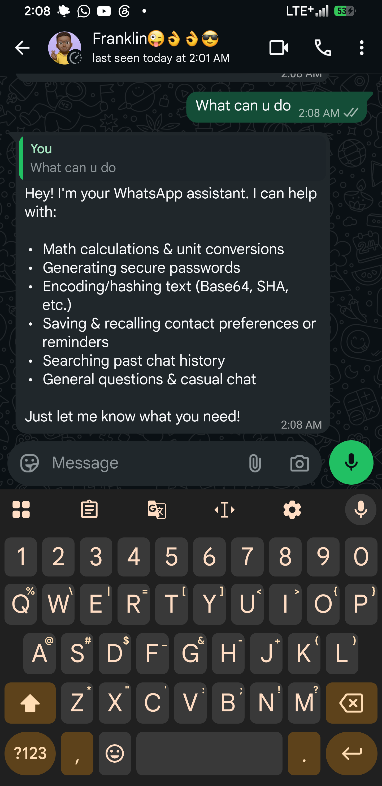
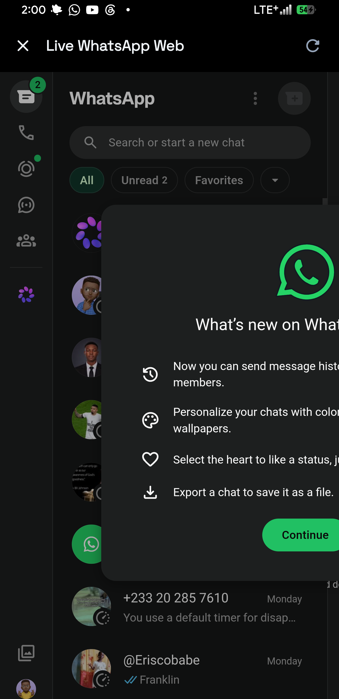
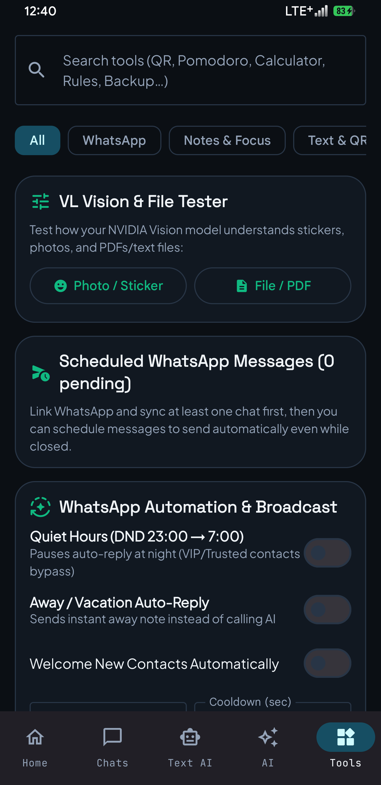
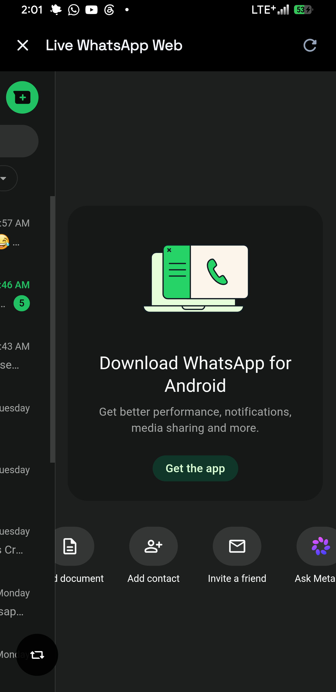

# ClawLink WA

<p align="center">
<b>AI WhatsApp auto-reply on Android — one tap, one APK, zero servers.</b>
</p>

<p align="center">
<a href="https://github.com/franklinatongo-code/clawlink-wa/releases/latest"></a>
<a href="#"></a>
<a href="#"></a>
<a href="#"></a>
<a href="#"></a>
<a href="#"></a>
</p>

<p align="center"><b>Install → Scan QR → Your AI answers your WhatsApp chats automatically.</b></p>

---

## 📱 What you see

<p align="center">



</p>

<p align="center">


</p>

| Screen | What it is |
|---|---|
| **Home** | Link status (Connected/Disconnected), chats count, messages count, AI replies count, quick links to open chats / Live WhatsApp Web / Switch Account |
| **AI chat** | Real WhatsApp chat where the AI has already answered — proof the bot talks back |
| **Live WhatsApp Web** | The real WhatsApp Web client running inside the app |
| **Tools** | Quiet hours (DND), away/vacation replies, welcome new contacts, cooldown, auto-react emoji |
| **Download page** | Known issue — WhatsApp serves its mobile download page instead of the web client when the desktop UA isn't applied |

---

## ✨ Features

- 🤖 **AI auto-reply** — your AI answers incoming WhatsApp chats automatically
- 🔗 **Real QR linking** — pairs as a genuine WhatsApp linked device
- 💾 **Persistent session** — survives app restarts and phone reboots; no re-scanning
- 💬 **Chats & AI replies view** — see conversations and what the AI said
- 🌐 **Live WhatsApp Web** — open the real web client inside the app
- 🔄 **Switch account** — cleanly clears the session for a fresh QR
- 🛠 **Tools** — automation, quiet hours, away/welcome replies, cooldowns, auto-react emoji
- 📱 **Single APK** — ~24 MB, installs on any Android 7.0+ phone

---

## 🚀 Get started in 60 seconds

**1. Download**

Get the first working build from **Releases**:

→ [Download ClawLink-WA-1.0.apk](https://github.com/franklinatongo-code/clawlink-wa/releases/latest/download/ClawLink-WA-1.0.apk)

**2. Install**
Enable “Install unknown apps” for your browser or file manager, then open the APK.  
Or from a computer:

```bash
adb install ClawLink-WA-1.0.apk
```

**3. Link WhatsApp**
Open ClawLink WA → **Link WhatsApp** → on your phone go to **WhatsApp → Linked devices → Link a device** → scan the QR shown in the app.

**4. Configure your AI**
Enter your AI endpoint/key (OpenAI-compatible or NVIDIA NIM). Your AI now answers incoming chats automatically.

---

## 🧠 How it works

ClawLink WA does **not** re-implement WhatsApp. It loads the real `web.whatsapp.com` inside Android's system WebView — the same browser already on your phone — and injects a tiny JavaScript helper that talks back to the app.

```
┌─────────────────────────────────────────────────────────┐
│  Your phone                                             │
│                                                         │
│  WhatsApp Web (real client, inside WebView)             │
│  ┌─────────────┐                                       │
│  │  New msg ✉  │ ──►  Msg.on('add')                    │
│  └─────────────┘      (wa_boot.js)                      │
│                                                         │
│  AndroidWA  (@JavascriptInterface)                      │
│     inbound JSON ──────────────────────────► Kotlin     │
│                                                         │
│  Kotlin engine                                          │
│     filter → dedupe → seen → typing ON                  │
│                                                         │
│  Your AI (OpenAI-compatible / NVIDIA NIM)               │
│     writes the reply                                    │
│                                                         │
│  Kotlin engine                                          │
│     typing OFF → __waReply() → WhatsApp                 │
│                                                         │
│  ┌─────────────┐                                       │
│  │ Sent ✅     │ ◄────── window.WWebJS.sendMessage      │
│  └─────────────┘                                       │
└─────────────────────────────────────────────────────────┘
```

1. **Pair** — scan the QR with WhatsApp → Linked devices → Link a device
2. **Listen** — `wa_boot.js` hooks `Msg.on('add')` and forwards new messages through `AndroidWA`
3. **Think** — Kotlin calls `Llm.reply(chatId, text)`; your AI writes the words
4. **Send** — `__waReply()` sends the reply back into WhatsApp, optionally quoting the original message

> [!quote] Nothing is templated
> The AI returns the reply text, and that exact text is what gets sent.

---

## 🔍 Search tags

`whatsapp automation` · `whatsapp auto-reply` · `whatsapp bot android` · `whatsapp web automation` · `ai whatsapp assistant` · `no-server android app` · `webview whatsapp` · `linked devices`

---

## 📋 Requirements

- Android 7.0+ (minSdk 24)
- Up-to-date **Android System WebView** — WhatsApp Web needs a modern WebView
- Internet connection
- An AI API key/endpoint (OpenAI-compatible; NVIDIA NIM endpoint is built in)

---

## ⚠️ Honest notes

- **Unofficial client.** This drives the WhatsApp Web client, which Meta does not officially support for automation. Use a **spare number** — bans are possible. For a business, use the official WhatsApp Cloud API.
- **Background pauses.** Android may throttle a backgrounded WebView; replies are instant when the app is open.
- **WhatsApp changes.** WhatsApp sometimes renames internal page modules; if replies stop after an update, the injected helper needs a tweak.
- **Package name.** Build 1.0 uses `com.example` — a real package name is coming in the next release.

---

## 🔖 Version & package

- Version: **1.0** (versionCode `1`)
- Package: `com.example`
- minSdk 24 · targetSdk 36 · ~24 MB APK

---

## 📄 Third-party

The injected JavaScript helpers derive from [`whatsapp-web.js`](https://github.com/pedroslopez/whatsapp-web.js) (Apache-2.0). See [`THIRD_PARTY_NOTICES.md`](THIRD_PARTY_NOTICES.md) and [`licenses/whatsapp-web.js-LICENSE`](licenses/whatsapp-web.js-LICENSE).

ClawLink WA is not affiliated with or endorsed by WhatsApp, Meta, or the whatsapp-web.js maintainers.
