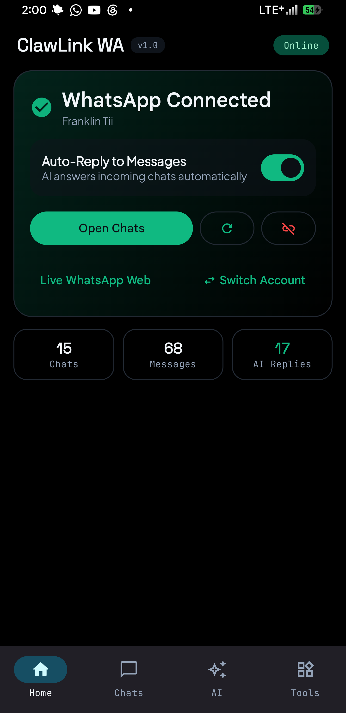
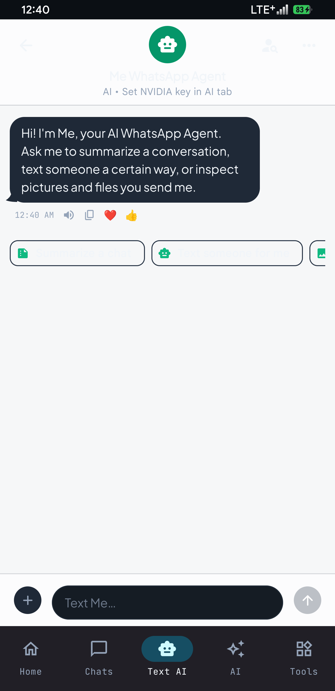
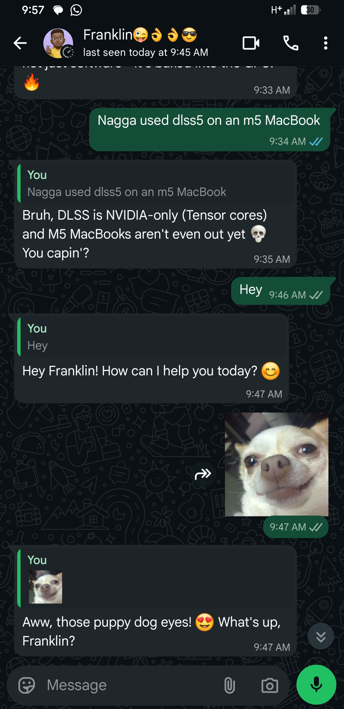

# 🚀 ClawLink WA — AI WhatsApp Auto-Reply on Android

<p align="center">
  <b>Install → Scan QR → Your AI answers WhatsApp chats automatically. 24/7. Hands-free.</b>
</p>

<p align="center">
  <!-- Core badges -->
  <a href="https://github.com/franklinatongo-code/clawlink-wa/releases/latest">
    
  </a>
  <a href="https://github.com/franklinatongo-code/clawlink-wa/releases/latest/download/ClawLink-WA-1.0.apk">
    
  </a>
  
  
  
  
  
  
  <!-- Fun/sticker badges -->
  
  
  
  
  
  
</p>

---

## 🎯 What is this?

**ClawLink WA turns your Android phone into an AI WhatsApp agent.**  
It loads the *real* WhatsApp Web client inside your phone's own browser (WebView), pairs just like WhatsApp Desktop, and lets an AI answer chats, understand photos/voice/PDFs, run on a schedule, and act as your chat assistant — **24/7, hands-free.**

| ❌ No computer | ❌ No Node.js | ❌ No self-hosted server | ❌ No protocol re-invention |
|:---:|:---:|:---:|:---:|
| ✅ Install APK | ✅ Link number once | ✅ Let AI do the talking | ✅ Works offline (Vosk) |

---

## 📸 Screenshots — Every screen is a tool

| Home — Link once | Chats Workspace | Text AI Assistant | AI Capabilities |
|:---:|:---:|:---:|:---:|
|  |  |  |  |

| Tools Hub (100+) | Voice & Reply Styles | Live in the Wild |
|:---:|:---:|:---:|
|  |  |  |

> **Not mockups.** Real WhatsApp conversations answered by the agent — no scripts, no canned lines.

<p align="center">
  <a href="https://github.com/franklinatongo-code/clawlink-wa/releases/latest/download/ClawLink-WA-1.0.apk">
    
  </a>
  <br><sub>Android 7.0+ · ~66 MB · Link with QR → live in under a minute</sub>
</p>

---

## ✨ Feature Highlights

<details open>
<summary><b>🔗 Linking & Background Operation</b></summary>

- **Fast QR pairing** — countdown + instant refresh + 8-digit phone pairing code
- **Live WhatsApp Web view** — inspect/interact with the session inside the app
- **Persistent login** — cookies, localStorage, IndexedDB kept on-device with auto-reconnect
- **One-tap Switch Account** — clean sign-out, fresh QR
- **24/7 background** — foreground service, WakeLock, keepalive alarms, boot/update auto-restart
- **Quick Settings tile** — toggle auto-reply from notification shade
- **Hidden owner key vault** — PIN-protected API key reveal/copy behind header badge
</details>

<details>
<summary><b>🤖 AI Agent & Group Intelligence</b></summary>

- **8-way parallel, deduplicated pipeline** — Room job queue + per-chat reply locks
- **Group intelligence** — separates 1:1 from groups, extracts participant names/JIDs/@mentions, per-group memory, **Mention-Only** mode
- **Hard send-layer protection** — group replies blocked at send/schedule layer, not just by prompt
- **Media understanding** — vision (retries blurry/refusals with high-res), WebP/Lottie stickers, PDFs, voice notes (Cloud AI or **offline Vosk**)
- **Natural realism** — typing indicators, read receipts, delay slider, quote replies, optional AI signature
- **Prompt-injection guard** + per-chat permission tiers (Standard / Restricted / Trusted / Blocked)
</details>

<details>
<summary><b>💬 Chats Workspace & Manual AI Backup</b></summary>

- **Frosted-glass, sci-fi UI** — single-pane phone + list-detail tablet/foldable layouts
- **Filters & live search** — All, Unread, Groups, Direct, Leads & CRM
- **Business Command HUD** — live CRM metrics (leads, sales, support, urgent, appointments)
- **Rich bubbles** — participant labels, quoted previews, media/voice insight chips, Translate, Read Aloud, Export to Markdown
- **Manual AI dock** — Reply with AI Now, Keep Replying catch-up, Smart Draft, 1-tap Summarize
- **Per-contact/group rules** — auto-reply toggle, permission tier, custom prompt, language, style
</details>

<details>
<summary><b>🧠 Personal Assistant (Text AI)</b></summary>

- **iMessage-style chat** — streamed replies, live tool status, reactions, copy, delete, TTS, dictation
- **Natural-language WhatsApp control** — list chats, read/summarize, update instructions, save facts, send/schedule messages
- **Multimodal attachments** — images (Photo Picker), PDFs, audio, text for visual Q&A, OCR, transcription
- **Contact picker shortcut** + built-in math + device telemetry tools
</details>

<details>
<summary><b>⚙️ AI Brain, Context & Multi-Provider Studio</b></summary>

- **Capability toggles** for direct chats, groups, pictures, stickers, files/PDFs, voice, alerts
- **Voice mode switch** — Off / Cloud / Offline (Vosk) with downloadable language packs
- **Personality presets** — Friendly Helper, Short & Crisp, Business Formal, Study Tutor, Code Helper, Translator
- **Context modes** — Hybrid Recent+Summary, Recent only, Summary only (1–50 messages + cached media insights)
- **Business Mode** — brand name, reply tone, products/services/pricing/hours catalog
- **Multi-provider routing** — NVIDIA NIM or custom OpenAI-compatible endpoint, encrypted key, live tester, **automatic fallback**, searchable model catalog (Vision/Tools/Audio)
</details>

<details>
<summary><b>🧰 Automation, Productivity & Utility Hub (100+ tools)</b></summary>

- **WhatsApp automation** — scheduled queue (sends while closed), Quiet Hours/DND with VIP bypass, Away/Vacation auto-reply, keyword rules (contains/exact/prefix/regex), welcome messages, auto-react, cooldown, snippets, multi-chat broadcast, token leaderboard
- **Vision & file tester** — run any photo/sticker/PDF through the media pipeline
- **Focus & notes** — Pomodoro, stopwatch, box breathing, to-do, habit streaks, quick notes, TTS pad
- **QR & text** — QR maker (URL/text/wa.me/Wi-Fi), WhatsApp formatting, word/char/line/reading-time stats, case converters, slugger, sort/dedupe, extractors
- **Math, finance & health** — scientific evaluator, 8-category unit converter, tip splitter, loan/EMI, BMI, event countdowns
- **Dev & crypto** — password/passphrase/UUID, JSON, Base64, URL, Hex, Binary, SHA-256/512, MD5, HMAC-SHA256, JWT, regex tester, epoch, ROT13, Morse, world clocks, WCAG contrast, dice/coin/random
- **Device & diagnostics** — Light/Dark/OLED/System themes, haptics, CPU/RAM/storage/battery/network telemetry, JSON backup/restore (API keys excluded), E2EE session stats, AI/WhatsApp diagnostics, categorized live logs
</details>

---

## 🚀 Get Started in 60 Seconds

### 1️⃣ Download
| Edition | Theme | Package | Download |
|:---:|:---:|:---|:---|
| 🔵 **Blue** (main) | Blue accents | `com.example.tsegst` | [ClawLink-WA-1.0.apk](https://github.com/franklinatongo-code/clawlink-wa/releases/latest/download/ClawLink-WA-1.0.apk) |
| 🟢 **Classic** | Green accents | `com.example.ilabmg` | [ClawLink-WA-1.0-ilabmg.apk](https://github.com/franklinatongo-code/clawlink-wa/releases/download/v1.0.0-blue/ClawLink-WA-1.0-ilabmg.apk) |

> Both install **side-by-side** (different package names). Links on [latest release](https://github.com/franklinatongo-code/clawlink-wa/releases/latest).

### 2️⃣ Install
Enable "Install unknown apps" for your browser/file manager → open APK.  
Or via ADB:
```bash
adb install ClawLink-WA-1.0.apk
```

### 3️⃣ Link WhatsApp
Open ClawLink WA → **Link WhatsApp** → on phone: **WhatsApp → Linked devices → Link a device** → scan QR in app.

### 4️⃣ Configure AI
Enter your AI endpoint/key (OpenAI-compatible or NVIDIA NIM). AI now answers automatically.

---

## 🔨 Build from Source

```bash
cd android
./gradlew assembleDebug   # -> app/build/outputs/apk/debug/app-debug.apk
```
- Requires: JDK 17 + Android SDK (compileSdk 35)
- Configure AI: edit `BASE_URL`, `MODEL`, `API_KEY` in [`Llm.kt`](android/app/src/main/java/app/waweb/local/Llm.kt)

> The reference source builds as `app.waweb.local`. Published APKs are newer/fuller builds with different package names.

---

## 🧠 How It Works (The Short Version)

```
┌─────────────────────────────────────────────────────────┐
│  Your Phone                                             │
│                                                         │
│  WhatsApp Web (real client, inside WebView)             │
│  ┌─────────────┐                                       │
│  │  New msg ✉  │ ──► Msg.on('add')  (wa_boot.js)       │
│  └─────────────┘                                       │
│                                                         │
│  AndroidWA (@JavascriptInterface)                       │
│     inbound JSON ──────────────────────► Kotlin        │
│                                                         │
│  Kotlin Engine                                          │
│     filter → dedupe → seen → typing ON                 │
│                                                         │
│  Your AI (OpenAI-compatible / NVIDIA NIM)              │
│     writes the reply                                   │
│                                                         │
│  Kotlin Engine                                          │
│     typing OFF → __waReply() → WhatsApp                │
│                                                         │
│  ┌─────────────┐                                       │
│  │ Sent ✅     │ ◄────── window.WWebJS.sendMessage     │
│  └─────────────┘                                       │
└─────────────────────────────────────────────────────────┘
```

**Key insight:** We don't re-implement WhatsApp. We load the *real* `web.whatsapp.com` in Android's system WebView and inject a tiny JS helper that bridges to Kotlin. No Node, no Puppeteer, no bundled Chromium.

<details>
<summary><b>📖 Full technical deep-dive</b></summary>

Read **[HOW_IT_WORKS.md](HOW_IT_WORKS.md)** for:
- WebView spoofing & origin lock
- Two-file injection order (`wa_utils.js` → `wa_boot.js`)
- Inbound hook: `WAWebCollections.Msg.on('add')`
- Single-thread executor for ordering
- Filtering logic (fromMe, groups, backlog, dedupe)
- AI call: OpenAI-compatible `chat/completions`
- Send path: `__waSend()` → `WWebJS.sendMessage()`
- Persistence: cookies + DOM storage + IndexedDB survive reboots
- Project layout & why no server needed
</details>

---

## 📱 Requirements

| Requirement | Details |
|:---|:---|
| **Android** | 7.0+ (published APK), minSdk 24 (source) |
| **WebView** | Up-to-date Android System WebView |
| **Network** | Internet connection |
| **AI** | OpenAI-compatible API key/endpoint (NVIDIA NIM built-in) |

---

## ⚠️ Honest Notes

- **Unofficial client** — drives WhatsApp Web, which Meta doesn't officially support for automation. **Use a spare number** — bans are possible. For business, use the [official WhatsApp Cloud API](https://developers.facebook.com/docs/whatsapp/cloud-api).
- **Background pauses** — Android may throttle backgrounded WebView; replies instant when app is open.
- **WhatsApp changes** — internal page modules occasionally rename; if replies stop after update, injected helper needs a tweak.
- **Two packages** — editions use `com.example.tsegst` (Blue) and `com.example.ilabmg` (Classic), install alongside each other.

---

## 📦 Version & Verification

| | |
|:---|:---|
| **Version** | 1.0 (versionCode `1`) |
| **minSdk / targetSdk** | 24 / 36 |
| **APK Size** | ~66 MB (includes offline Vosk models) |
| **API Keys** | None embedded — add your own in-app |

| Edition | Package | SHA-256 |
|:---|:---|:---|
| 🔵 **Blue** | `com.example.tsegst` | `7aed8f9a3ef1db1bec366ecdc4536264d73201a9a5846552c43030e8fd6164b7` |
| 🟢 **Classic** | `com.example.ilabmg` | `d1253979798ba6283debf46a8f6128c98b1250d4847e6b109e404bd5a106db3e` |

> Screenshots show Classic theme; Blue uses same layout with blue accents.

---

## 📄 Third-Party & License

- **License:** Apache 2.0
- **Reference helpers** derive from [`whatsapp-web.js`](https://github.com/pedroslopez/whatsapp-web.js) (Apache-2.0)
- **Shipped build** uses trimmed, custom helper implementation
- See [`THIRD_PARTY_NOTICES.md`](THIRD_PARTY_NOTICES.md) and [`licenses/whatsapp-web.js-LICENSE`](licenses/whatsapp-web.js-LICENSE)

> ClawLink WA is not affiliated with or endorsed by WhatsApp, Meta, or whatsapp-web.js maintainers.

---

## 🔍 Search Tags

`whatsapp automation` · `whatsapp auto-reply` · `whatsapp bot android` · `whatsapp web automation` · `ai whatsapp assistant` · `no-server android app` · `webview whatsapp` · `linked devices` · `vosk offline speech` · `nvidia nim`

---

<p align="center">
  <b>⭐ Star this repo if you want to see WhatsApp auto-reply keep evolving.</b><br>
  <sub>Built with ☕ and late nights. PRs welcome — make it better.</sub>
</p>

<p align="center">
  <a href="https://github.com/franklinatongo-code/clawlink-wa/stargazers">
    
  </a>
  <a href="https://github.com/franklinatongo-code/clawlink-wa/forks">
    
  </a>
  <a href="https://github.com/franklinatongo-code/clawlink-wa/issues">
    
  </a>
</p>