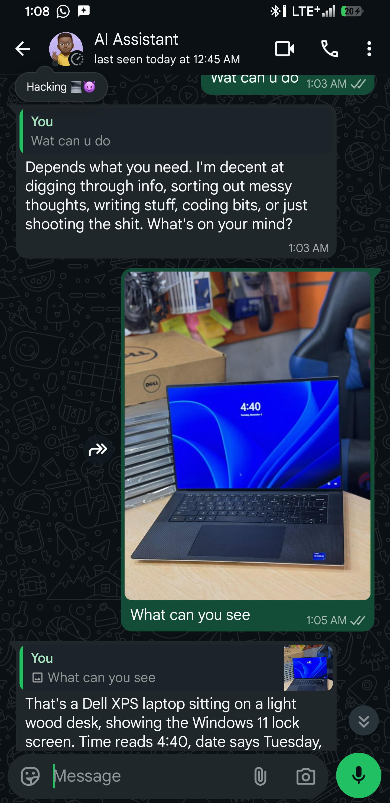
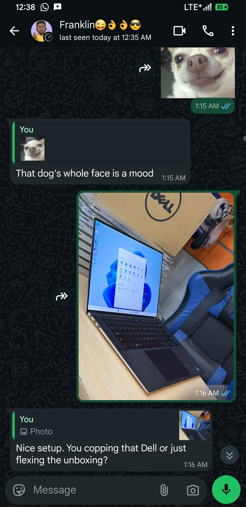
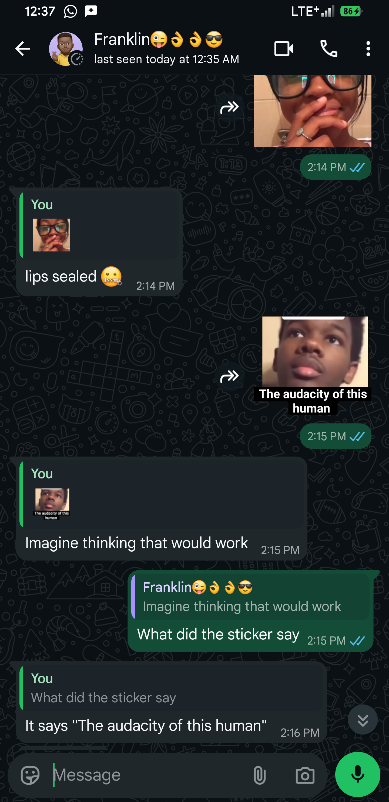
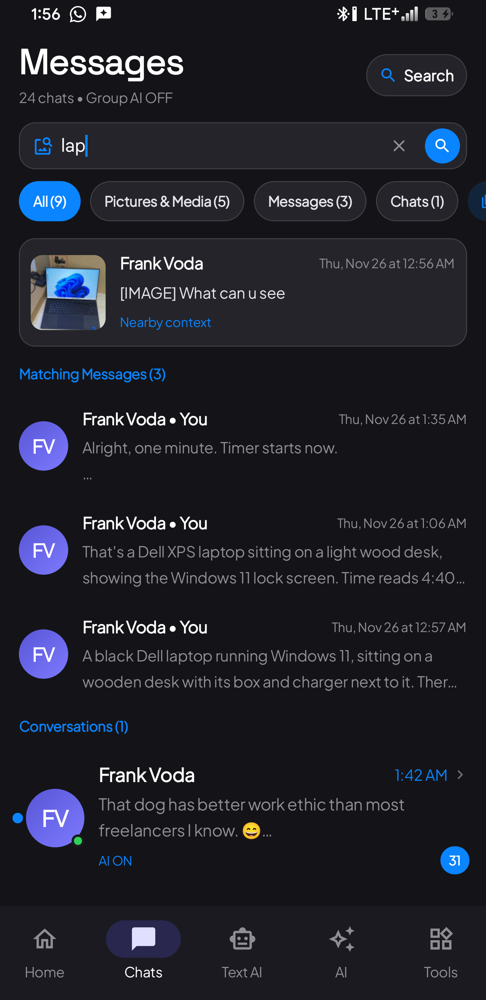
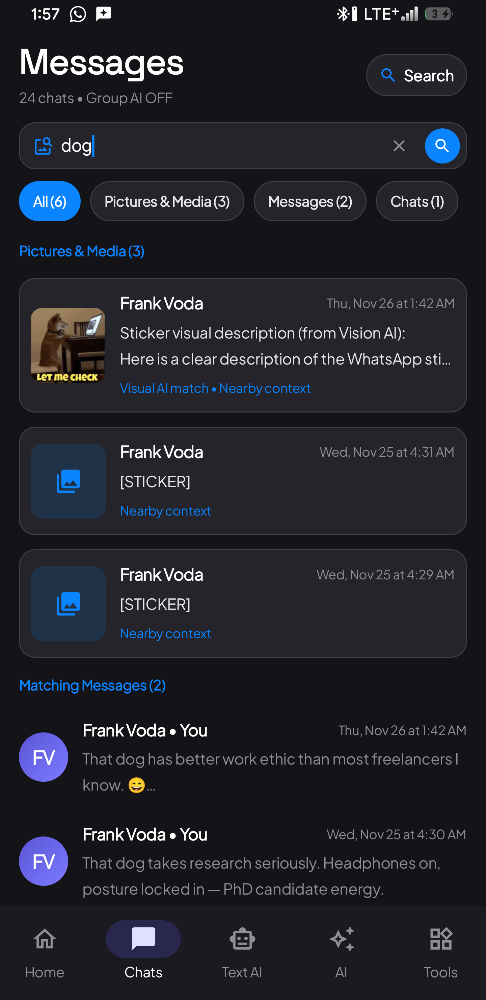
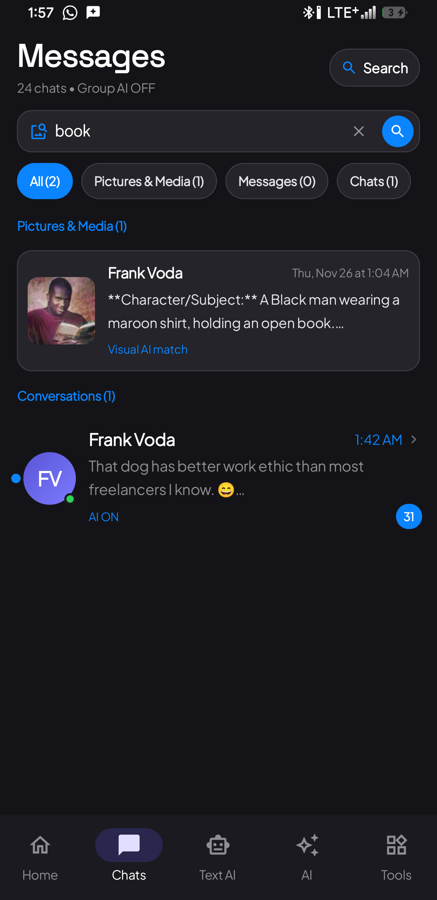
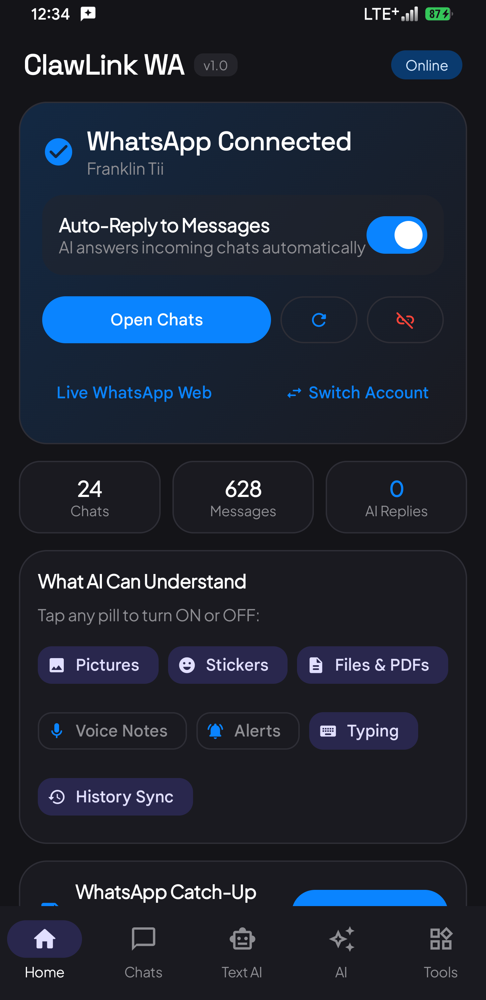
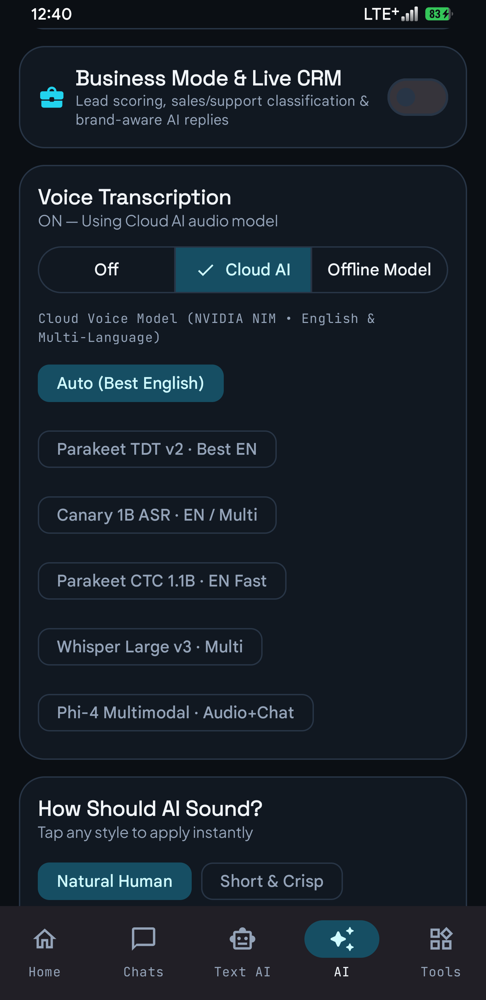
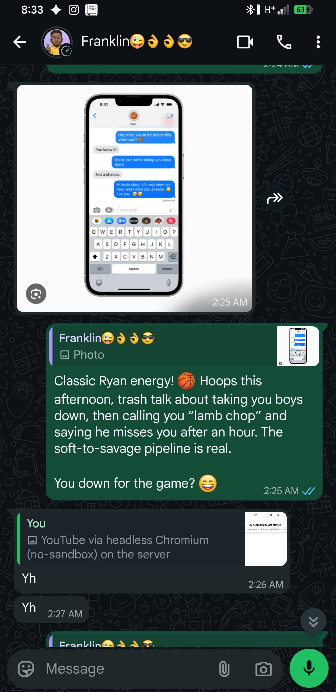

<div align="center">

# ClawLink WA

### Your Android phone becomes an AI WhatsApp agent.

Install the APK, scan one QR, and an AI answers your chats, understands photos and voice notes,
and keeps working while the app is closed.

**No PC. No server. No Node.js. No re-implemented WhatsApp protocol.**

[](https://github.com/franklinatongo-code/clawlink-wa/releases/latest/download/ClawLink-WA-1.0.apk)
[](https://github.com/franklinatongo-code/clawlink-wa/releases)
[](#requirements)
[](#build-from-source)
[](LICENSE)

</div>

---

## See it

Real screens. Real WhatsApp chats. No mock-ups.

### It talks like a friend, not a bot

<table>
<tr>
<td align="center" width="50%">
<br/>
<b>Ask anything. It answers like a person.</b><br/>
No corporate boilerplate. Send a photo of your desk and it names the laptop, reads the lock
screen, and keeps the tone human.
</td>
<td align="center" width="50%">
<br/>
<b>It reads the room — and the photo.</b><br/>
Dog picture, laptop flex, running joke. It replies to what is actually in the image and matches
the mood of the chat.
</td>
</tr>
<tr>
<td align="center" width="50%">
<br/>
<b>Stickers included.</b><br/>
Ask what a sticker said and it reads the meme back to you. Static, animated and Lottie stickers
all understood.
</td>
<td align="center" width="50%">
<br/>
<b>It knows its own toolbox.</b><br/>
Ask "what can you do" and it explains its tools in plain language, so you always know what to
ask next.
</td>
</tr>
</table>

### Search your chats by what is inside the picture

ClawLink writes a vision description for every photo, sticker and file, so you can search your
history the way you actually remember it.

<table>
<tr>
<td align="center" width="33%">
<br/>
<b>Search "lap", find the laptop.</b><br/>
Media results, matching messages and nearby context in one place.
</td>
<td align="center" width="33%">
<br/>
<b>Search "dog", surface the sticker.</b><br/>
Every sticker gets a description, so plain text search finds images.
</td>
<td align="center" width="33%">
<br/>
<b>Search "book", land on the exact photo.</b><br/>
"A man in a maroon shirt holding an open book" — that is the index doing its job.
</td>
</tr>
</table>

### The control room

<table>
<tr>
<td align="center" width="50%">
<br/>
<b>One screen tells you it is alive.</b><br/>
Connection status, 24 chats, 628 messages, media toggles and a one-tap catch-up briefing.
</td>
<td align="center" width="50%">
<br/>
<b>Link once, stay linked.</b><br/>
QR code or 8-digit pairing code. The session lives on your phone, so you never scan again.
</td>
</tr>
<tr>
<td align="center" width="50%">
<br/>
<b>A toolbox in the same APK.</b><br/>
Scheduled messages, quiet hours, away mode, keyword rules, broadcast, QR, calculators.
</td>
<td align="center" width="50%">
<br/>
<b>Every chat, one workspace.</b><br/>
DMs and groups with live AI status, search, and All / Unread / Groups filters.
</td>
</tr>
<tr>
<td align="center" width="50%">
<br/>
<b>You set the boundaries.</b><br/>
Per-capability switches for chats, groups, pictures, stickers, files, voice and alerts.
</td>
<td align="center" width="50%">
<br/>
<b>An assistant that can use WhatsApp.</b><br/>
"Summarize my chat with John." "Text Mary I'm running late." Attach a photo or PDF.
</td>
</tr>
<tr>
<td align="center" width="50%">
<br/>
<b>Talk to it. Make it sound like you.</b><br/>
Cloud or offline transcription, NVIDIA NIM audio models, and reply-style presets.
</td>
<td align="center" width="50%">
<br/>
<b>It holds a conversation.</b><br/>
Quoted replies, reactions, and a personality that reads the room.
</td>
</tr>
<tr>
<td align="center" width="50%">
<br/>
<b>It understands photos.</b><br/>
Send an image and it replies to what is actually in the picture, not to the file name.
</td>
<td align="center" width="50%" valign="middle">
<b>Ready to see it on your own chats?</b><br/><br/>
<a href="https://github.com/franklinatongo-code/clawlink-wa/releases/latest/download/ClawLink-WA-1.0.apk"><b>Download the APK (66 MB) →</b></a><br/><br/>
Android 8.0+. One QR scan. No PC, no server, no Node.js.
</td>
</tr>
</table>

> Screenshots and the feature list below describe the full build published in
> [Releases](https://github.com/franklinatongo-code/clawlink-wa/releases). The [`android/`](android)
> source in this repo is the reference implementation of the core loop — see
> [Source vs. release](#source-vs-release).

---

## What it does

ClawLink WA loads the **real WhatsApp Web client** inside your phone's own browser engine (WebView).
It pairs exactly like WhatsApp Desktop — scan a QR once, and the session persists across restarts.
An AI then answers incoming messages automatically, understands photos, stickers, PDFs and voice
notes, and runs scheduled work while the app is closed.

| Traditional approach | ClawLink WA |
|:---|:---|
| Requires a computer or server | Runs entirely on your phone |
| Needs Node.js, Puppeteer, Chrome | Uses the WebView already on your device |
| Re-implements the WhatsApp protocol | Loads the real `web.whatsapp.com` |
| Complex setup, ongoing maintenance | Install APK → scan QR → done |

---

## Feature highlights

<details open>
<summary><b>Linking, persistence and background operation</b></summary>

- Fast QR pairing with countdown and instant refresh, plus an 8-digit **phone-number pairing code**
- **Persistent login** — cookies, localStorage and IndexedDB stay on-device with auto-reconnect
- **Live WhatsApp Web** view to inspect or interact with the session
- **24/7 background operation** — foreground service, WakeLock, keepalive alarms, boot/update restart
- One-tap **Switch Account**, and a **Quick Settings tile** to toggle auto-reply from the shade
- **Home overview** — chats / messages / AI replies stats, media toggles, and a one-tap catch-up briefing

</details>

<details>
<summary><b>AI agent and group intelligence</b></summary>

- Parallel, deduplicated reply pipeline with per-chat locks — no double-replies, even on reload
- **Group intelligence** — separates 1:1 from groups, reads participant names and @mentions,
  keeps per-group memory, and supports **mention-only** mode
- **Hard send-layer group protection** — when group replies are off, sends are blocked below the prompt
- **Media understanding** — vision for photos, static/animated WebP and Lottie stickers, PDFs and
  documents, plus voice notes via Cloud AI or **offline Vosk**
- **Natural realism** — typing indicators, read receipts, delay, quoted replies, optional signature
- Prompt-injection guard and per-chat permission tiers (Standard / Restricted / Trusted / Blocked)

</details>

<details>
<summary><b>Chats workspace</b></summary>

- Frosted-glass UI with single-pane phone layout and list-detail tablet/foldable layout
- **Filters and live search** — All, Unread, Groups, Direct, Leads & CRM
- **Business Command HUD** — live CRM metrics and per-chat category badges
- **Rich bubbles** — quoted previews, media/voice insight chips, inspect media, translate,
  read aloud, dictation, export to Markdown
- **Manual AI dock** — reply with AI now, keep-replying catch-up, smart draft, one-tap summarize
- Per-contact and per-group rules — auto-reply, permission tier, custom prompt, language, style,
  context window, CRM category and saved memory facts

</details>

<details>
<summary><b>Personal assistant (Text AI)</b></summary>

- iMessage-style chat with streamed replies, live tool status, reactions, copy, delete, TTS, dictation
- **Natural-language WhatsApp control** — list chats, read or summarize a conversation, update a
  contact's instructions, save a fact, send a message (respecting group permissions), or schedule one
- **Multimodal attachments** — images via the Android photo picker, plus PDFs, audio and text
- Contact-picker shortcut and built-in math plus device telemetry tools

</details>

<details>
<summary><b>AI brain, context and providers</b></summary>

- Capability toggles for direct chats, groups, pictures, stickers, files/PDFs, voice and alerts
- **Voice mode** — Off / Cloud / Offline (Vosk) with downloadable language packs
- **Personality presets** plus temperature, token cap, delay, streaming, name, prompt, style, language
- **Context modes** — hybrid recent + summary, recent only, summary only, with an N-message reader
- **Business Mode** — brand name, reply tone, and a products / pricing / hours catalog
- **Multi-provider routing** — NVIDIA NIM or any OpenAI-compatible endpoint, encrypted key, live
  endpoint tester, automatic fallback, and a searchable model catalog

</details>

<details>
<summary><b>Automation and productivity</b></summary>

- **Scheduled messages** that send while the app is closed
- **Quiet Hours / DND** with VIP bypass, **away / vacation auto-reply**, welcome messages, auto-react
- **Keyword rules** (contains / exact / prefix / regex), cooldown, snippets, multi-chat broadcast
- Vision and file tester, Pomodoro, stopwatch, box breathing, to-do, habits, quick notes
- QR maker, WhatsApp formatting, text stats, case converters, slugger, sort/dedupe, extractors
- Scientific calculator, unit converter, tip splitter, loan/EMI, BMI, countdowns
- Password / UUID, JSON, Base64, URL, Hex, Binary, SHA-256/512, MD5, HMAC, JWT, regex, epoch, ROT13,
  Morse, world clocks, contrast checker, dice/coin/random
- Themes (Light / Dark / OLED / System), haptics, device telemetry, JSON backup and restore

</details>

---

## How it works

ClawLink WA does **not** re-implement WhatsApp. It loads the real `web.whatsapp.com` inside Android's
system WebView — the same browser already on your phone — and injects a small JavaScript helper that
talks back to the app.

```
┌─────────────────────────────────────────────────────────┐
│  Your phone                                             │
│                                                         │
│  WhatsApp Web (real client, inside WebView)             │
│  ┌─────────────┐                                        │
│  │  New msg    │ ──►  Msg.on('add')                      │
│  └─────────────┘      (wa_boot.js)                       │
│                                                         │
│  AndroidWA  (@JavascriptInterface)                      │
│     inbound JSON ──────────────────────────► Kotlin     │
│                                                         │
│  Kotlin engine                                          │
│     filter → dedupe → seen → typing ON                  │
│                                                         │
│  Your AI (OpenAI-compatible / NVIDIA NIM)               │
│     writes the reply                                    │
│                                                         │
│  Kotlin engine                                          │
│     typing OFF → __waReply() → WhatsApp                 │
│                                                         │
│  ┌─────────────┐                                        │
│  │ Sent        │ ◄────── window.WWebJS.sendMessage      │
│  └─────────────┘                                        │
└─────────────────────────────────────────────────────────┘
```

1. **Pair** — scan the QR with WhatsApp → Linked devices → Link a device
2. **Listen** — `wa_boot.js` hooks `Msg.on('add')` and forwards new messages through `AndroidWA`
3. **Think** — Kotlin calls `Llm.reply(chatId, text)`; your AI writes the words
4. **Send** — `__waSend()` sends the reply back into WhatsApp, optionally quoting the original

Want the engine room — webpack module registry, ciphertext events, the bridge threat model,
persistence internals and failure modes? Read **[HOW_IT_WORKS.md](HOW_IT_WORKS.md)**.

---

## Get started

### 1. Download

Pick an edition from [Releases](https://github.com/franklinatongo-code/clawlink-wa/releases):

| Edition | Asset | Package | Notes |
|:---|:---|:---|:---|
| **Blue (main)** | [`ClawLink-WA-1.0.apk`](https://github.com/franklinatongo-code/clawlink-wa/releases/latest/download/ClawLink-WA-1.0.apk) | `com.example.tsegst` | Latest build; the screenshots above |
| Classic | [`ClawLink-WA-1.0-ilabmg.apk`](https://github.com/franklinatongo-code/clawlink-wa/releases/latest/download/ClawLink-WA-1.0-ilabmg.apk) | `com.example.ilabmg` | Earlier full build |

Both packages install side by side, so you can try one without losing the other.

### 2. Install

Enable "Install unknown apps" for your browser or file manager, then open the APK. Or from a computer:

```bash
adb install ClawLink-WA-1.0.apk
```

### 3. Link WhatsApp

Open ClawLink WA → **Link WhatsApp** → on your phone go to **WhatsApp → Linked devices → Link a
device** → scan the QR shown in the app.

### 4. Configure your AI

Enter your AI endpoint and key (OpenAI-compatible or NVIDIA NIM). Your AI now answers incoming
chats automatically.

---

## Source vs. release

The [`android/`](android) project in this repository is the **reference implementation of the core
loop**: WebView shell, origin lock, helper injection, message hook, filtering, LLM call, and send.
It builds as `app.waweb.local`.

The APK published in Releases is a **newer, fuller build** with the complete UI and feature set shown
in the screenshots. It is packaged separately (`com.example.tsegst` / `com.example.ilabmg`). The
reference source is not a 1:1 mirror of the shipped UI.

---

## Build from source

You need **JDK 17** and the **Android SDK** (`compileSdk 35`).

```bash
cd android
./gradlew assembleDebug
# Output: app/build/outputs/apk/debug/app-debug.apk
```

To point the AI at your own endpoint, edit the three constants at the top of
[`Llm.kt`](android/app/src/main/java/app/waweb/local/Llm.kt) (`BASE_URL`, `MODEL`, `API_KEY`), then
rebuild.

---

## Requirements

| Component | Minimum |
|:---|:---|
| Android | 8.0 (API 26) |
| System WebView | Current version (WhatsApp Web needs modern Chromium) |
| Internet | Required for WhatsApp Web and the AI API |
| AI API | Any OpenAI-compatible endpoint or NVIDIA NIM |

---

## Project structure

```
android/
├── app/
│   ├── src/main/
│   │   ├── java/app/waweb/local/
│   │   │   ├── MainActivity.kt    # WebView host, injection, bridge, filtering
│   │   │   └── Llm.kt             # AI reply seam (OpenAI-compatible)
│   │   ├── assets/
│   │   │   ├── wa_utils.js        # Upstream whatsapp-web.js Utils.js
│   │   │   └── wa_boot.js         # Injection, Msg hook, __waSend
│   │   └── AndroidManifest.xml
│   └── build.gradle.kts
├── gradle/
├── gradlew
├── settings.gradle.kts
└── build.gradle.kts
```

---

## Known limitations (honest)

- **Unofficial client** — this automates WhatsApp Web, which Meta does not officially support. Use a
  spare number. For production business use, use the
  [WhatsApp Cloud API](https://developers.facebook.com/docs/whatsapp/cloud-api).
- **Background throttling** — Android may pause a backgrounded WebView. The shipped build uses a
  foreground service and WakeLock; the reference source does not.
- **WhatsApp module drift** — WhatsApp occasionally renames internal webpack modules. If replies stop
  after a WhatsApp Web update, the injected helpers need a tweak.
- **Reference source is text-only** — image, document and voice handling live in the shipped build,
  not in the `android/` reference implementation.
- **Single-threaded reference loop** — a slow LLM call blocks other chats in the reference source.
  The shipped build parallelises per chat.

---

## Roadmap

- [ ] Publish the full UI source
- [ ] Foreground service + WakeLock in the reference source
- [ ] Media understanding in the reference source (vision, voice transcription, stickers)
- [ ] Settings UI in the reference source (no rebuild needed)
- [ ] Offline voice via Vosk in the reference source

---

## License

Apache 2.0 — see [`LICENSE`](LICENSE).

The injected helpers in `assets/wa_utils.js` derive from
[whatsapp-web.js](https://github.com/pedroslopez/whatsapp-web.js) (Apache 2.0). See
[`THIRD_PARTY_NOTICES.md`](THIRD_PARTY_NOTICES.md).

---

## Disclaimer

ClawLink WA is not affiliated with, endorsed by, or connected to WhatsApp, Meta, or the
whatsapp-web.js maintainers. This is an independent project for educational and personal automation
purposes.
